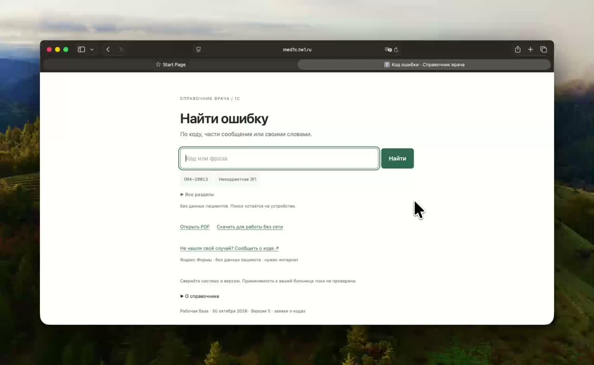

# Справочник врача по ошибкам 1С

Когда программа показывает непонятный код, а работу нужно продолжить. Введите код или несколько слов из сообщения — справочник подскажет, что проверить и когда обратиться в поддержку.

**[Открыть справочник →](https://med1c.tw1.ru/)** · [Скачать PDF](doctor_guide.pdf) · [Версия без интернета](doctor_guide_mobile.html)

## Как это работает

[▶ Смотреть видео — 42 секунды](docs/media/demo.mp4)

Поиск понимает коды, фрагменты сообщений и описание ситуации своими словами. Если ответа нет, можно отправить код на проверку. Вход и установка не нужны.

В базе **174 разбора**. В каждой карточке — краткое объяснение, действия врача и ссылка на источник. Подтверждённые сведения и возможные причины отмечены отдельно.

Системы на 1С отличаются между больницами: перед применением сверяйте конфигурацию и контекст. Проверка на рабочих местах конкретной больницы пока не проводилась. Не вводите данные пациентов.

## Что внутри

[Справочник](doctor_guide.md) · [Краткая памятка](doctor_quick_reference.md) · [База JSON](errors.json) · [Таблица CSV](errors.csv) · [Источники](sources.md)

Для работы с проектом: [сборка и проверки](docs/development.md), [правила пополнения](docs/contributing.md), [отчёт исследования](research_report.md).
